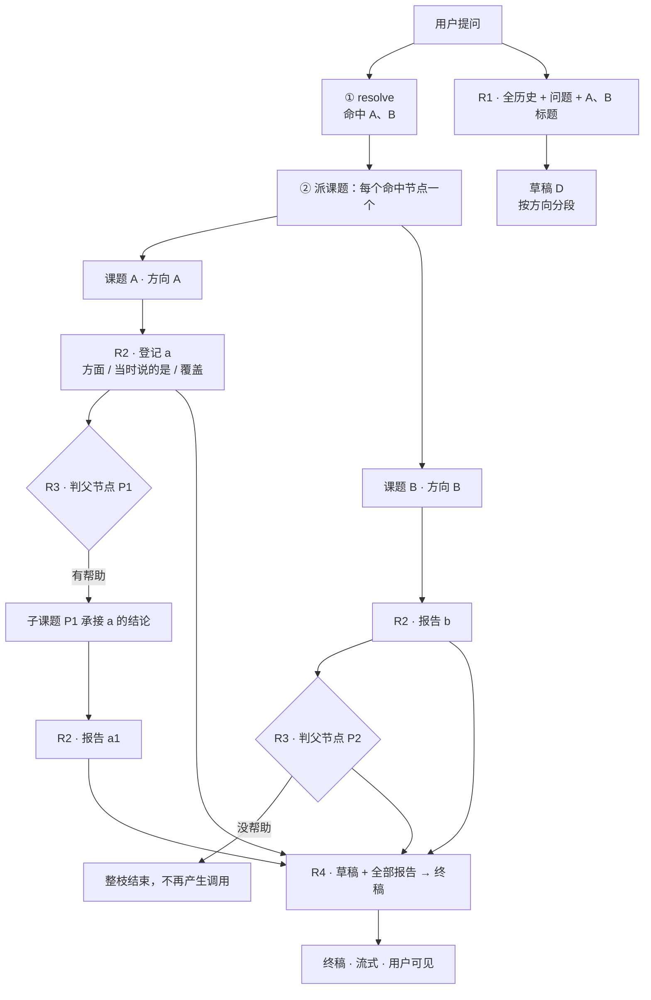

# L3 渐进式取回：设计（课题组分包）

> 状态：已实施（2026-10-24，`agent/lib/l3-tasks.js`），开关 `data/config/l3-mode` 写 `tasks` 生效。
> 本文只写"考虑了哪些方面、打算怎么处理"，不写代码——实施时偏离本文的地方见 §9。

**一句话**：引用命中后不再把整条来路扒进上下文，而是先写一版草稿，再把每个知识点当成一个
**课题**分包去查旧讨论，沿来路逐层追问，最后连同全部课题报告汇总成终稿；材料与报告都只活在
这一轮，不进历史。

---

## 1. 问题：钱花在一段"每轮重发、永远命不中"的来路

现在的 L3：`resolveCitations` 判出命中节点后，`userAncestry` 一次 BFS 把来路全取（上限 12 个节点），
`l3Block` 全部渲染成一段文本，**每轮**塞进请求。

2026-10-20 实测：

| 指标 | 数值 |
|---|---|
| 这段来路本身 | 76,305 字符 ≈ **47,309 token** |
| 当天主回复输入 | 2,450,146 token |
| 当天主回复未命中 | 1,182,946 token（其中约 1.1M 是它） |

**为什么永远命不中**：它位于"会增长的历史"之后，每一轮绝对位置都在变，而前缀缓存按位置匹配——
位置一变就作废，内容再稳定也没用。

顺带量出两件事：

- **12 是硬截断**：真实来路闭包是 **41 个节点、7 跳深**，现在的上限按跳数砍掉 29 个，与相关性无关。
- **aliases 是大头**：41 个节点的 point 合计 1.9k 字符，aliases 合计 50.3k 字符（**96%**）。
  但那是"41 个一起看"的代价；本方案每次只看**一个**节点的 point+aliases（≈750 token），不贵。

## 2. 方案：R1 草稿 → 派课题 → R3 逐层判父 → R4 汇总



> 编辑器不渲染 mermaid 时看 PNG 版：`images/l3-flow.png`。

| 步骤 | 看什么 | 产出 |
|---|---|---|
| **R1** | 全历史 + 本轮问题 + 命中节点的标题（只有 point） | 草稿 D，按方向分段 |
| **R2**（每个课题一次） | 当前提问 + 这一枝的课题 + 该节点原话 | 一份固定字段的**史料登记** |
| **R3**（每层一次） | 草稿 + 父节点 point+aliases（有的变体再加子报告结论） | 有帮助 / 没帮助 |
| **R4** | 草稿 D + 全部报告 | 终稿，流式 |

**关键**：R2 不重写草稿，只交报告。草稿全程只被 R4 改一次——这避免了"每补一次就重写一遍、
第三次重写时第一次的细节已经淡了"的损耗。

### 2.3 开关与 A/B 基线（2026-10-24 用户定调）

**旧路径不删。** 现在的 `resolveCitations → userAncestry → l3Block` 整条链原样保留，连同
`lib/l3-context.js` 的渲染规则和它的测试。新方案是**并列的另一条路径**，共用
`resolveReferences` 的命中结果；两条都留着，因为要用同一个输入对比输出。

**切换不需要重启。** 开关是一个文件，每次调用现读：

```
data/config/l3-mode      一行，取值：
  full   旧路径：整条来路全量渲染（默认）
  tasks  新路径：R1 → 派课题 → R3 → R4
  both   两条同跑：旧路径的回答给用户看，新路径那份跑在后台，两份终稿并排进脑图
  off    不发 L3（用于第 0 步因果验证）
```

文件缺失或读不懂 → 一律按 `full` 走。理由：默认值必须是"今天的行为"，否则一次误写文件
就悄悄改了线上表现。

**切换不用改文件**：侧栏发 `/l3` 看当前、`/l3 tasks|full|both|off` 切、`/l3 debug on|off` 开关调试。
指令走系统消息通道（与 `/相处` 同一套），不进历史、不进栈、不调模型。

**both 的取舍**：给用户看的仍然是**旧路径**那份，新路径只进记录。理由——这是对比模式，
不是替换；阅读体验不该因为"我在做实验"而降级，历史里留下的也该是已知可靠的那一版。
觉得新的更好，再 `/l3 tasks` 把它扶正。代价：引用那一轮两条都跑，慢一倍、贵一倍。

**回归测试**：`full` 模式产出的 L3 块必须与改造前逐字节一致。否则"基线"会在重构里悄悄漂移，
A/B 就白做了。

**A/B 怎么做**：三种，按"要不要花钱"排：

| 方式 | 怎么做 | 拿到什么 |
|---|---|---|
| 只量体量 | `node agent/scripts/l3-ab.mjs`（先抓一轮输入） | 两边各要发多少 token，不花钱 |
| 真跑两条 | `/l3 both` + `/l3 debug on`，照常提问 | 同一份输入的两份终稿并排画在脑图里；旧路径那份就是你看到的回答 |
| 离线重放 | `node agent/scripts/l3-ab.mjs --live` | 同样的对比，但可以反复跑、可以换 `--no-judge-child` 试变体 |

不做线上分流（一半用户走 A、一半走 B）——引用一天只有 2 次，分流凑不出样本。`both` 不是分流：
它每一轮两条都跑，对比的是同一个输入，不抽样。重放时缓存是冷的，所以只看"两条路径的相对差"，
绝对值以线上 usage 报表为准。

**只在"有新命中"的那轮跑**：旧路径每轮都注入（栈里挂着的引用也算种子），那是"每轮重发"的
病根本身。新路径只在用户这轮新指认到节点时跑一次；下一轮不再重跑，因为报告里的结论已经
写进上一轮给用户的回答，那段回答就在历史里。

## 3. 两类规范（成败在这里）

> 2026-10-24 用户纠正了这里的方向：原来是**父节点自己找活儿**（拿子节点的结论判断"这枝值不值得追"，
> 再套一个通用问句"有没有更深一层的原因"），等于让父节点替子节点猜该挖什么。现在改成
> **谁有缺口谁点题，谁有材料谁答题**。下面三节都已按新方向改写。

### 3.1 课题派发

**A. 派给命中节点**（唯一固定的题）

```
【课题 K-1】方向：<该节点的 point>
要回答：在草稿这一段里，这条旧讨论里有哪些**具体内容**能支撑、细化或校正判断？
材料：<该节点原话>
```

**B. 往更早的讨论派**——**问题由子节点自己写**，父节点只围绕这一问作答

子节点只看候选父节点的**标题 + 别名编号**——正文不给它，给了就等于让它拿材料猜材料；
判断哪一条里已经说过的话能补上自己缺的那一处：

```
你在课题 K-1 上刚交了一份报告。
结论：<K-1 的报告结论>
你还缺：<K-1 报告里的「缺口」>
【候选材料】K-1.1「标题」 1. 别名一  2. 别名二
            K-1.2「标题」 1. 别名一
每条材料占一行：K-1.1：<缺的那一处> —— 第几条，要它交出那一部分   /   K-1.2：无
```

被点题的父节点拿到的就是那一句：

```
【课题 K-1.1】K-1 提给你的问题：<子节点写的那一句>
材料：<父节点原话>
```

**它不拿到草稿，也不知道子节点的结论**——题面已经把需求说清楚了，它只负责用自己的材料回答。

### 3.2 课题报告（固定字段，不许自由发挥）

三行文本（**不是 JSON**，理由见 §9.1 第一跑）：

```
方面：当前提问要的那一面（一个短语；无关写 无关）
结论：2~4 句，可直接并入终稿的具体内容（≤160 字）
当时说的是：只用材料里的说法归纳一两句（**不许引原话、不许加引号**）
对应：草稿里哪个方向名
覆盖：够 | 只沾边 | 没有
```

- `关系: 无` 是**剪枝信号**：不再往上点题、不参与汇总。
- `缺口` 是**下一层派不派题的唯一依据**：写了"无"，这一枝就到此为止（也最省钱）。
- 对父节点来说：`补充`＝材料确实答上了这一问，`校正`＝材料跟这一问的预设相反，`无`＝材料里答不了。

### 3.3 汇总（R4）

```
输入：草稿 D + 全部报告（按课题号列出）
硬要求：
① 每条「关系 ≠ 无」的报告，结论必须落到终稿里
② 不许引入报告和草稿以外的内容
③ 草稿的整体判断保留；「关系＝校正」的按报告改
④ 输出纯正文（流式），不做 JSON
```

丢弃检测放在**程序**里：每条报告取一个特征短语，检查是否出现在终稿，没出现就记日志。
流式不受影响，还能拿到「R4 丢弃率」这个指标。（落地时改成"三元组重叠率"：模型整合时几乎
不照抄原句，按字面查特征短语会把它读成 100% 丢弃。日志里打的是**数值**，阈值可回看再调，
不当判决用。）

## 4. 剪枝、并发、兜底

- **剪枝**：R3 判否 → 不派子课题 → 那棵子树连一次调用都没有。今天 41 个节点、7 跳深，
  不剪的话就是 41 次 R2；剪完预计只走 3~5 个节点。
- **并发**：枝与枝并行（命中 A、B 同时派），枝内逐层串行。延迟取决于最长的那条枝，不是总和。
- **多父节点**：每个父节点各自派一个子课题，不需要在中间合并——所有报告都攒到 R4。
- **兜底闸**：语义停止由 R3 决定，程序再加一道硬闸（落地值：10 次探索调用 / 材料约 40k token /
  20 秒，先到先停）。**触发时记日志**，这样才知道是 R3 不肯停还是真的走了这么深。

## 5. 考虑到的方面
| 方面 | 打算怎么处理 | 理由 |
|---|---|---|
| 缓存 | R1 是纯追加形状；草稿/报告/材料都不进历史 | 10 万 token 的历史每轮只发一遍 |
| 成本 | 每次引用 ≈31k 未命中（2 命中 + 2 层来路） | 今天 2 次/天 ≈ 6 万，对比现在 110 万 |
| 延迟 | 引用那轮多一次草稿 + 若干小调用 + 一次终稿；其余轮次零变化 | 四步各一次往返。**实测待补**：粗估引用轮 20~40 秒（原估 5~8 秒偏乐观，草稿和终稿都是整篇生成） |
| 已显示内容 | R1 的草稿不可见 | 2026-10 定调：流式已显示的内容不能被事后替换 |
| 草稿形态 | 只要「要点 + 没底的地方」，不写成品 | 草稿是给课题和汇总用的工作稿 |
| 终稿约束 | 只整合、不改结论；程序侧逐条对账 | 放开会丢掉 R1 已做出的判断（实施时 R4 仍带全历史：前缀本来就命中，省不了几个钱，而少了历史更容易写成报告腔） |
| 取回粒度 | 每次只给一个节点的原话，封顶 8k 字符（≈5k token） | 单条最大 15k token，不封顶会失控 |
| 越界 | 课题材料只来自当轮目录里的节点 | 防模型编 id、防它把整张图当工具翻 |
| 兜底 | 任何一步失败 → 退回草稿（至少不是空回复） | 引用轮不能没有答案 |
| 存储 | 不动 | 材料和报告不落库，`restoreHistories` 零改动 |
| 跨轮继承 | 同栈继续时，把**这场讨论里 live 过的来路节点**（累积，不是只留上一轮）并在本轮命中里重跑；弹栈/不入栈不继承，弹栈时清掉 | 材料只活一轮，第二问之后那几个旧节点就彻底失明了，只剩上一轮回答的复述可依赖。继承的是"节点"，材料仍然只在派到它时才读 |

### 5.1 跨轮继承的两条边界（2026-10-26 用户定）

- **继承什么**：`summary` 非空的来路节点（depth ≥ 1，即派出去的那些"更早的讨论"），**不设数量上限**，并且**累积**——第 1 轮 live 了 B、C，第 2 轮又 live 了 D、E，下一轮继承的就是 B、C、D、E。命中节点本身不继承（它每轮由引用解析重新决定要不要跑）。
- **什么时候不继承**：这一问导致**弹栈**（判专题化把旧讨论收口了）或**压根没入栈**。为此"判栈"这一步从回答之后提到了回答之前；代价是每轮多一次判断调用挡在首字之前。
- **图上怎么显示**：会意图高亮的口径 = 这一轮真正交给模型的（本轮引用命中 ∪ 继承来的节点），继承来的那一批在 reason 里标「（上轮继承）」。

**代价（明确接受）**：继承集合只增不减，一场长讨论里每轮要重读的节点会越来越多（每个 1.2 万~2.5 万字材料）。到那时该看的是 `stats` 里的"材料约 N token"有没有逼近 `maxTokens: 60000` 的闸。


## 6. 待定与对照实验

**R3 要不要看到子课题的结论**——做成开关，跑对照：

| | 变体 A | 变体 B |
|---|---|---|
| R3 看什么 | 草稿 + 父节点 point/aliases | 再加**子报告的结论** |
| 输入差 | — | +200 token |
| 量什么 | 子课题「关系≠无」的比例、每次引用总 token、终稿人评 | 同 |

另外两个待定：**硬闸参数**、**命中数上限**（不做硬截断，超过 3 个时只记日志）。

## 7. 明确不做

- **不接 tool calling 协议**：R2/R3/R4 语义上就是函数调用（模型选、程序执行），但先用"独立小调用
  + 文本协议"落地：不声明 `tools`、不读 `tool_calls`。理由是 `tools` 常驻会让每轮都暴露一次调用能力，
  而只有引用轮才需要它。将来换 `tools` 时，业务函数与报告格式不变。
- **不做 search**（清单外检索）：命中判定已经给出候选集，等有数据再说。
- **不动 resolve**：12 万 token 的引用判定是另一件事，别捆在一起改。
- **不动存储层**：材料和报告不进库，是这套方案最大的简化。

## 8. 验收

1. **离线重放**：用 2026-10-20 那两次真实引用，跑 R1 → 派课题 → R3，人工看：课题有没有派对方向、
   报告有没有答到点上。这一步不通过，后面调汇总没有意义。
2. **上线看 usage**：`node agent/scripts/usage-report.mjs` 里「主回复」的未命中应从 ~46k/轮 降到 ~2k/轮。
3. **丢弃率**：R4 每天丢弃的报告比例应从日志里能算出来；长期高于 10% 说明课题规范或汇总规范要改。
4. **对照**：R3 变体 A/B 各跑一段时间，比子课题的有效率。

## 9. 实施记录（2026-10-24）

代码在 `agent/lib/l3-tasks.js`（纯逻辑，LLM 调用与图查询由 `say()` 注入；
`agent/test/l3-tasks.test.js` 用假模型跑完整条链路：调用顺序、剪枝、硬闸、停止信号）。

**实施时偏离本文的地方**：

| 位置 | 本文说 | 实施成 | 为什么 |
|---|---|---|---|
| R4 输入 | 草稿 + 全部报告 | 再加**全历史 + 画像** | 历史前缀本来就命中，几乎不加钱；少了历史更容易写成报告腔 |
| R3 粒度 | 每层一次 | 每层一次，但**这一层的全部候选父节点一起判** | 1 跳实测有 6 个节点，逐个判会先把兜底闸吃满，轮不到 R2 |
| 丢弃检测 | 特征短语是否出现 | 结论三元组在终稿里的重叠率（记数值） | 整合时不会照抄原句，按字面查等于恒判丢弃 |
| 失败兜底 | 任何一步失败 → 退回草稿 | 同：R1 失败 → 退回旧的整段注入；R2/R3 失败 → 只汇总草稿 | 引用轮不能没有答案 |

**量出来的数**（2026-10-24，真图 202 节点；命中节点取"来路最深"的两个；
用假模型跑**真流水线**，不调 API；脚本 `test/scratch/l3-tasks-dry.mjs`）：

| | 旧路径 full | 新路径 tasks |
|---|---|---|
| 一次引用 | 64,474 token/轮（12 节点闭包，每轮重发） | A 保守 14,016 / B 最坏 32,983（撞 10 次调用闸） |
| 一场 8 轮讨论 | 515,792 | ≤ 32,983（只花一轮，约 16×） |

口径：字符 × 0.62 估算（与 `TOKEN_PER_CHAR` 同源），不是服务商回报的数；缓存是冷的，所以这里
只比"要发多少**未命中的新内容**"，不比账单。B 撞的是**调用数**闸，不是 token 闸。

**还没做的**：无（`both` 与离线重放都已落地）。
**要盯的数**：引用轮主回复未命中（首轮冷缓存，目标 ~30k）、非引用轮（~1~2k）、
R4 丢弃率、探索阶段兜底闸触发率、引用轮实际耗时。

### 9.1 首次真跑（2026-10-24，节点 n_mujha3h1_4，模型 deepseek-v4-flash）

拿会意图里「外来调查者为什么卡在现场」这个节点，把**它自己的讨论问题**当本轮提问，两条路各跑一次
（`node agent/scripts/l3-ab.mjs --node <id> --live`）：

| | 调用 | input | 其中未命中 | output | 耗时 |
|---|---|---|---|---|---|
| A 旧路径 | 1 | 46,627 | 45,603（冷缓存） | 2,650 | 23.4s |
| B 新路径 | 9 | 29,521 | 19,537 | 15,200 | 112.4s |

**三个发现（都是这次实跑才暴露的）**：

1. **让推理模型吐长 JSON 不可靠**：报告写 3~6 句塞进 JSON 字符串时，正文会在字符串中间截断，
   而 `finish_reason` 报的是 `stop`（看起来成功了，实际 JSON 没闭合，解析必失败）。
   改成**四行文本**（关系/结论/依据/对应），截断也只丢最后一行。
2. **20 秒的兜底闸是错的**：一次 R2 实测 9~20 秒，20 秒的闸在第一枝上就触发，流水线永远跑不完。
   改成 120 秒；真正防跑飞的是「10 次调用」和「40k 材料 token」。
3. **推理税**：思考也算 output，每次子调用 1,000~3,300 token 是思考。9 次调用 = 15,200 output——
   于是**单轮的 token 账和旧路径基本持平（44.7k vs 49.3k），但慢了 5 倍**。
   省钱的账要按整场讨论算：旧路径每轮都重发 46k，8 轮 = 368k；新路径只在命中那轮花 ~45k。

**质量**（同题两份终稿，人工看）：旧路径那份更紧、更具体；新路径那份结构更整齐，但更像"建议清单"，
末尾把 3 跳外的祖先（列宁式政治操作、多轮共同承担）硬接了进来——因为 §3.3 ① 要求"每条报告结论
都必须落进终稿"，而 R3 追得太深。两个待调项：`maxDepth` 收到 1、允许 R4 丢掉不相关的报告。

**又跑了两轮之后补记**：

- **判父也会被思考吃光**：一次 R3 出了 8,799 字思考、0 字正文，那一层的 4 个候选全被画成"未追"
  ——其实是**没问成**。现在判父预算 2,048 → 6,144，候选索引截到 40 字，判父失败在图上标"未判"。
- **同一输入跑三次，A 的字数在 1,251 / 2,367 / 1,424 之间跳，B 是 1,110 / 1,065 / 1,094**。
  单跑一次不足以下结论——要比就各跑三次看中位，别拿一次的长短当"更好/更差"。
- 对拍脚本现在也产**脑图**（与 App 内是同一个渲染器）：`--node <id> --live` 会写出
  `<时间>-脑图.html` / `<时间>-全过程.md` / `<时间>.md`（两份终稿 + 每次调用的 token 账），
  外加 `<时间>-事件.json`——只改"图怎么画"时用 `--from-events` 重渲染，不必再花钱跑一遍。
- 图上每个课题现在写着**派的是什么题**（`课题（查这条旧讨论）` / `课题（承接上一层往下挖）`
  + `上一层结论`）。那段文字与实际发出去的提示词**共用同一个常量**，图不会说谎。

### 9.2 派题的依据是标题/别名，所以"父节点答不上来"是元数据问题（2026-10-24 用户点出）

子节点决定派不派题，看的是父节点的 **point（标题）+ alias（别名）**——正文不发给它，
所以它判"能不能补"靠的是别名本身有没有承诺那块内容。
所以父节点回一句"无关"，不能读成"这一枝没用"——它只能说明**标题/别名承诺了正文里没有的东西**。

处理方式：
- 派给父节点的题里，把它的标题/别名原样摆出来，并允许它直说"标题提到 X，正文里没有"；
- 这种情况记成一个 **mismatch 事件**（图上标红字、逐字记录里单独一行、统计里数个数），
  而不是静悄悄剪掉这一枝；
- 也就是说：这一枝断掉的责任在旧讨论的元数据，不在课题目录。

### 9.2 最大的成本项是"思考"，不是报告（2026-10-24 实测）

同一个 R2 报告调用，四种参数各跑一次（同一份材料、同一份提示词）：

| 参数 | 总输出 | 其中思考 | 正文 | 正文长度 | 耗时 |
|---|---|---|---|---|---|
| 现状（不加参数） | 2,336 | **2,172（93%）** | 164 | 235 字 | 14.0s |
| `thinking: {type:"disabled"}` | **152** | 0 | 152 | 232 字 | **1.5s** |
| `reasoning_effort: "low"` | 3,172 | 2,972 | 200 | 295 字 | 19.9s |
| `reasoning_effort: "none"` | 128 | 0 | 128 | 173 字 | 1.5s |

**正文长度几乎不变**（235 → 232 字），但输出少 93%、快 10 倍。`reasoning_effort` 无效（low 反而想更多），
只有 `thinking.type=disabled` 管用。

所以：**R2 报告、R3 派题这两类"机械调用"一律关思考**（`lib/l3-tasks.js` 里传 `thinking:false` +
`contentOnly:true`），R1 草稿与 R4 终稿仍开着（那是写给人看的）。同一节点的总输出：**24,865 → 6,200**，
单次报告 **26.1s / 4,096 token → 1.4s / 129 token**。这也顺带解决了"时间闸老撞"——原来 10 次调用
× 14 秒就是 140 秒，现在 10 次 × 1.5 秒。

代价：关掉思考后**派题更保守**（同一节点从"派 3 个"变成"派 1 个"）。如果发现该派的不派，
可以只给「派题」留思考——它每个分支只有一次调用，是这套里唯一值得为判断力付费的地方。

用量报表也跟着改：`output` 之外单独记一格 `think`（`completion_tokens_details.reasoning_tokens`），
控制台会打「输出 900（其中思考 800）」，不再让思考混在"报告有多长"里。

**全过程怎么看**（调试）：`data/config/l3-debug` 存在时，每轮写两份东西：

- `data/runtime/l3-trace/<时间>.html`——**脑图**，跑完自动用浏览器打开。节点是课题：
  命中/来路几跳、材料多少字、关系是补充还是校正、结论、依据对不对得上原文；
  **虚线节点是 R3 判"不值得追"的枝**，一眼看出哪一枝断在哪。
- `data/runtime/l3-trace/<时间>.md`——逐字版，细节都在这里：① R1 草稿全文 ② 每一层的派题表
  （候选 × 派出的题 + 模型原始输出）、每块材料的摘录与登记 ③ 每层回归汇总的中转记录 ④ 终稿 + 覆盖度 + 耗时。

两份都是**边跑边写**的（一轮 30 秒，等的时候刷新就能看进度）；`onEvent` 抛错会被就地吃掉——
记录写不进去也绝不影响这一轮回答。

**A/B 怎么跑**（同一份输入，两条路各出一份终稿）：

1. `data/config/` 下建一个空文件 `l3-debug`（调试开关，内容随便）；
2. 照常在侧栏问一次引用了旧知识点的问题。这一轮会得到两样东西：
   `data/runtime/l3-trace/<时间>.md`（**命题递归全过程**：草稿全文、每个课题的材料规模与报告、
   R3 在哪些候选里挑了谁、R4 的输入、终稿、覆盖度）和 `data/config/l3-dump.json`（这一轮的完整输入）。
   全过程是**边跑边写**的，等的时候就能打开看；
3. `node agent/scripts/l3-ab.mjs` → 只看两边提示词多大；加 `--live` → 真调 API，两边各跑一次，
   两份终稿 + 每次调用的 token 账写到 `test/l3-ab/`；
4. 看完删掉 `l3-debug`（那份 json 与 md 里都是完整对话，别往外发）。
