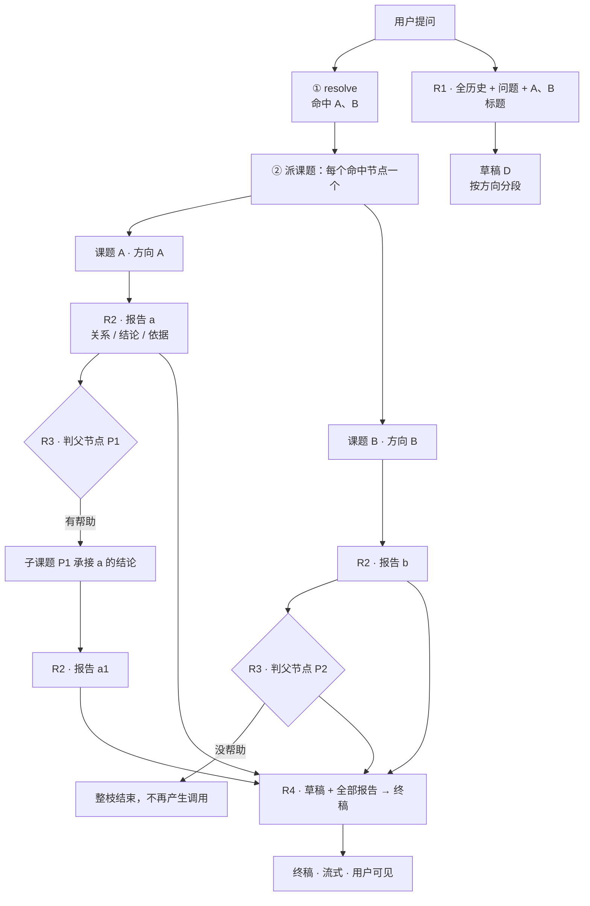

# L3 渐进式取回：设计（课题组分包）

> 状态：方案已定，待实施（2026-10-21）。本文只写"考虑了哪些方面、打算怎么处理"，不写代码。

**一句话**：引用命中后不再把整条来路扒进上下文，而是先写一版草稿，再把每个知识点当成一个
**课题**分包去查旧讨论，沿来路逐层追问，最后连同全部课题报告汇总成终稿；材料与报告都只活在
这一轮，不进历史。

---

## 1. 问题：钱花在一段"每轮重发、永远命不中"的来路

现在的 L3：`resolveCitations` 判出命中节点后，`userAncestry` 一次 BFS 把来路全取（上限 12 个节点），
`l3Block` 全部渲染成一段文本，**每轮**塞进请求。

2026-10-20 实测：

| 指标 | 数值 |
|---|---|
| 这段来路本身 | 76,305 字符 ≈ **47,309 token** |
| 当天主回复输入 | 2,450,146 token |
| 当天主回复未命中 | 1,182,946 token（其中约 1.1M 是它） |

**为什么永远命不中**：它位于"会增长的历史"之后，每一轮绝对位置都在变，而前缀缓存按位置匹配——
位置一变就作废，内容再稳定也没用。

顺带量出两件事：

- **12 是硬截断**：真实来路闭包是 **41 个节点、7 跳深**，现在的上限按跳数砍掉 29 个，与相关性无关。
- **aliases 是大头**：41 个节点的 point 合计 1.9k 字符，aliases 合计 50.3k 字符（**96%**）。
  但那是"41 个一起看"的代价；本方案每次只看**一个**节点的 point+aliases（≈750 token），不贵。

## 2. 方案：R1 草稿 → 派课题 → R3 逐层判父 → R4 汇总



> 编辑器不渲染 mermaid 时看 PNG 版：`images/l3-flow.png`。

| 步骤 | 看什么 | 产出 |
|---|---|---|
| **R1** | 全历史 + 本轮问题 + 命中节点的标题（只有 point） | 草稿 D，按方向分段 |
| **R2**（每个课题一次） | 课题说明 + 该节点原话 + 草稿 | 一份固定字段的**报告** |
| **R3**（每层一次） | 草稿 + 父节点 point+aliases（有的变体再加子报告结论） | 有帮助 / 没帮助 |
| **R4** | 草稿 D + 全部报告 | 终稿，流式 |

**关键**：R2 不重写草稿，只交报告。草稿全程只被 R4 改一次——这避免了"每补一次就重写一遍、
第三次重写时第一次的细节已经淡了"的损耗。

## 3. 两类规范（成败在这里）

### 3.1 课题派发

**A. 派给命中节点**

```
【课题 K-1】方向：<该节点的 point>
要回答：在草稿「<方向>」这部分，这条旧讨论里有哪些**具体内容**能支撑、细化或校正判断？
材料：<节点原话>
边界：只答这一问；不复述材料；不评价讨论质量；材料里没有的不许补。
```

**B. 派给父节点**（R3 判「有帮助」之后才派）

```
【课题 K-1.1】承接 K-1
上一层结论：<K-1 报告里的「结论」>
本层要回答：这条更早的讨论（<父节点 point>）里，有没有更深一层的原因 / 背景 / 反例，
           能解释或补强上一层的结论？没有就直接写「无」。
材料：<父节点原话>
边界：同上；只准沿着上一层结论往下挖，不许另开话题。
```

### 3.2 课题报告（固定字段，不许自由发挥）

```json
{
  "课题": "K-1",
  "关系": "补充 | 校正 | 无",
  "结论": "3~6 句，可直接并入终稿的具体内容",
  "依据": "原文里的一句，无则空串",
  "对应": "该落到草稿的哪个方向"
}
```

`关系: "无"` 是**剪枝信号**：不派子课题、不参与汇总。

### 3.3 汇总（R4）

```
输入：草稿 D + 全部报告（按课题号列出）
硬要求：
① 每条「关系 ≠ 无」的报告，结论必须落到终稿里
② 不许引入报告和草稿以外的内容
③ 草稿的整体判断保留；「关系＝校正」的按报告改
④ 输出纯正文（流式），不做 JSON
```

丢弃检测放在**程序**里：每条报告取一个特征短语，检查是否出现在终稿，没出现就记日志。
流式不受影响，还能拿到「R4 丢弃率」这个指标。

## 4. 剪枝、并发、兜底

- **剪枝**：R3 判否 → 不派子课题 → 那棵子树连一次调用都没有。今天 41 个节点、7 跳深，
  不剪的话就是 41 次 R2；剪完预计只走 3~5 个节点。
- **并发**：枝与枝并行（命中 A、B 同时派），枝内逐层串行。延迟取决于最长的那条枝，不是总和。
- **多父节点**：每个父节点各自派一个子课题，不需要在中间合并——所有报告都攒到 R4。
- **兜底闸**：语义停止由 R3 决定，程序再加一道硬闸（参数待定，建议 10 次循环 / 40k token /
  20 秒先到先停）。**触发时记日志**，这样才知道是 R3 不肯停还是真的走了这么深。

## 5. 考虑到的方面

| 方面 | 打算怎么处理 | 理由 |
|---|---|---|
| 缓存 | R1 是纯追加形状；草稿/报告/材料都不进历史 | 10 万 token 的历史每轮只发一遍 |
| 成本 | 每次引用 ≈31k 未命中（2 命中 + 2 层来路） | 今天 2 次/天 ≈ 6 万，对比现在 110 万 |
| 延迟 | 引用那轮多 5~8 秒；其余轮次零变化 | 派课题 + 逐层判 + 汇总各一次往返 |
| 已显示内容 | R1 的草稿不可见 | 2026-10 定调：流式已显示的内容不能被事后替换 |
| 草稿形态 | 只要「要点 + 没底的地方」，不写成品 | 草稿是给课题和汇总用的工作稿 |
| 终稿约束 | 只整合、不改结论；逐条对账 | R4 看不到全历史，放开会丢掉 R1 已做出的判断 |
| 取回粒度 | 每次只给一个节点的原话，封顶 8k 字符（≈5k token） | 单条最大 15k token，不封顶会失控 |
| 越界 | 课题材料只来自当轮目录里的节点 | 防模型编 id、防它把整张图当工具翻 |
| 兜底 | 任何一步失败 → 退回草稿（至少不是空回复） | 引用轮不能没有答案 |
| 存储 | 不动 | 材料和报告不落库，`restoreHistories` 零改动 |

## 6. 待定与对照实验

**R3 要不要看到子课题的结论**——做成开关，跑对照：

| | 变体 A | 变体 B |
|---|---|---|
| R3 看什么 | 草稿 + 父节点 point/aliases | 再加**子报告的结论** |
| 输入差 | — | +200 token |
| 量什么 | 子课题「关系≠无」的比例、每次引用总 token、终稿人评 | 同 |

另外两个待定：**硬闸参数**、**命中数上限**（不做硬截断，超过 3 个时只记日志）。

## 7. 明确不做

- **不接 tool calling 协议**：R2/R3/R4 语义上就是函数调用（模型选、程序执行），但先用"独立小调用
  + 文本协议"落地：不声明 `tools`、不读 `tool_calls`。理由是 `tools` 常驻会让每轮都暴露一次调用能力，
  而只有引用轮才需要它。将来换 `tools` 时，业务函数与报告格式不变。
- **不做 search**（清单外检索）：命中判定已经给出候选集，等有数据再说。
- **不动 resolve**：12 万 token 的引用判定是另一件事，别捆在一起改。
- **不动存储层**：材料和报告不进库，是这套方案最大的简化。

## 8. 验收

1. **离线重放**：用 2026-10-20 那两次真实引用，跑 R1 → 派课题 → R3，人工看：课题有没有派对方向、
   报告有没有答到点上。这一步不通过，后面调汇总没有意义。
2. **上线看 usage**：`node agent/scripts/usage-report.mjs` 里「主回复」的未命中应从 ~46k/轮 降到 ~2k/轮。
3. **丢弃率**：R4 每天丢弃的报告比例应从日志里能算出来；长期高于 10% 说明课题规范或汇总规范要改。
4. **对照**：R3 变体 A/B 各跑一段时间，比子课题的有效率。
