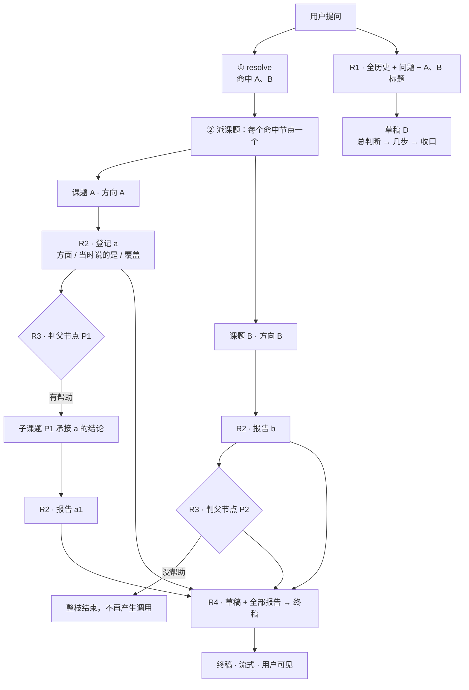

# L3 渐进式取回：设计（课题组分包）

> 状态：已实施（2026-10-24，`agent/lib/l3-tasks.js`），开关 `data/config/l3-mode` 写 `tasks` 生效。
> 本文只写"考虑了哪些方面、打算怎么处理"，不写代码——实施时偏离本文的地方见 §9。

**一句话**：引用命中后不再把整条来路扒进上下文，而是先写一版草稿，再把每个知识点当成一个
**课题**分包去查旧讨论，沿来路逐层追问，最后连同全部课题报告汇总成终稿；材料与报告都只活在
这一轮，不进历史。

---

## 1. 问题：钱花在一段"每轮重发、永远命不中"的来路

现在的 L3：`resolveCitations` 判出命中节点后，`userAncestry` 一次 BFS 把来路全取（上限 12 个节点），
`l3Block` 全部渲染成一段文本，**每轮**塞进请求。

2026-10-20 实测：

| 指标 | 数值 |
|---|---|
| 这段来路本身 | 76,305 字符 ≈ **47,309 token** |
| 当天主回复输入 | 2,450,146 token |
| 当天主回复未命中 | 1,182,946 token（其中约 1.1M 是它） |

**为什么永远命不中**：它位于"会增长的历史"之后，每一轮绝对位置都在变，而前缀缓存按位置匹配——
位置一变就作废，内容再稳定也没用。

顺带量出两件事：

- **12 是硬截断**：真实来路闭包是 **41 个节点、7 跳深**，现在的上限按跳数砍掉 29 个，与相关性无关。
- **aliases 是大头**：41 个节点的 point 合计 1.9k 字符，aliases 合计 50.3k 字符（**96%**）。
  但那是"41 个一起看"的代价；本方案每次只看**一个**节点的 point+aliases（≈750 token），不贵。

## 2. 方案：R1 草稿 → 派课题 → R3 逐层判父 → R4 汇总



> 编辑器不渲染 mermaid 时看 PNG 版：`images/l3-flow.png`。

| 步骤 | 看什么 | 产出 |
|---|---|---|
| **R1** | 全历史 + 本轮问题 + 画像（**不看命中标题**；派题那一步看候选目录） | 草稿 D：总判断 → 几步 → 收口，末尾附**待查清单** |
| **R2**（每个课题一次） | 当前提问 + 这一枝的课题 + 该节点原话 | 一份固定字段的**史料登记** |
| **R3**（每层一次） | 草稿 + 父节点 point+aliases（有的变体再加子报告结论） | 有帮助 / 没帮助 |
| **R4** | 草稿 D + 全部报告 | 终稿，流式 |

**关键**：R2 不重写草稿，只交报告。草稿全程只被 R4 改一次——这避免了"每补一次就重写一遍、
第三次重写时第一次的细节已经淡了"的损耗。

### 2.3 开关与 A/B 基线（2026-10-24 用户定调）

> **2026-10-27 晚：切正式。** `data/config/l3-mode` 现在是 `tasks`——旧路径不再跑，新路径就是
> 用户读到的那份回答（`both` 那条 `〔A · 旧路径〕` 对照气泡随之消失）。旧代码一行没删：把文件
> 改回 `full` 或 `both` 就能退回去，下一句提问生效。`both` 留着，做对照实验时还能用。
> 记录也跟着走：以前是 `both` 顺手带来"每轮写脑图/逐字版"，现在 `tasks` 自己也写，否则切模式
> 那一刻起就悄悄查不到"它当时看到什么"了。

**旧路径不删。** 现在的 `resolveCitations → userAncestry → l3Block` 整条链原样保留，连同
`lib/l3-context.js` 的渲染规则和它的测试。新方案是**并列的另一条路径**，共用
`resolveReferences` 的命中结果；两条都留着，因为要用同一个输入对比输出。

**切换不需要重启。** 开关是一个文件，每次调用现读：

```
data/config/l3-mode      一行，取值：
  full   旧路径：整条来路全量渲染（对照用；现在不走）
  tasks  正式路径：R1 → 派课题 → R3 → R4 + 联网验证
  both   两条同跑：**新路径的回答给用户看**，旧路径那份跑在后台、另起一条气泡对照
  off    不发 L3（用于第 0 步因果验证）
```

文件缺失或读不懂 → 一律按 `full` 走。理由：兜底必须落在"已知能用的那一档"，否则一次误写文件
就悄悄改了线上表现。

**切换不用改文件**：侧栏发 `/l3` 看当前、`/l3 tasks|full|both|off` 切、`/l3 debug on|off` 开关调试。
指令走系统消息通道（与 `/相处` 同一套），不进历史、不进栈、不调模型。

**both 的取舍**（2026-10-27 对调）：以前给用户看的是**旧路径**那份、新路径只进记录；
现在反过来——**新路径为主**，流式给用户看、落库、进历史；旧路径为辅，跑完另起一条
`〔A · 旧路径〕` 气泡，只显示、不进历史。

对调的理由：新路径已经是默认（`tasks`）要做的事，`both` 是拿它跟旧路径对照，
那么"用户看到的那份"就该是将来要用的那份，否则每读一轮都在读要被替换掉的东西。
代价没变：两条都跑，慢一倍、贵一倍。

**停止信号跟着主路径走**：信号是"读到即删"，所以只能有一个消费者。对调后归新路径
（它内部的 `checkStop` 也一起生效）；旧路径那条是普通调用，不读信号。

**停止时撤销什么、不撤销什么**（2026-10-27 查清）：

| 东西 | 什么时候写 | 停止时 |
|---|---|---|
| 会意栈（专题化/同一性判定） | 只在 `applyStackTurn` 里，**回答之后** | 不写，所以不用撤 |
| 弹栈收口（写正式图谱） | 同上 | 不跑，不用撤 |
| live 继承记录 | 同上 | 不清（下一轮重新判） |
| 图命中事件 | 新路径：**流水线判完、终稿流式之前**（要等"哪几个真用上了"）；旧路径：提问后立刻 | 按 `payload.replyToTs` **只删本轮那条** |

最后一格是 2026-10-27 修的一个洞：原来删的是整场对话的全部命中事件，
等于"停一轮、清空整本书亮过的点"。认不出是哪一轮时**一条都不删**，绝不退化成全删。

**回归测试**：`full` 模式产出的 L3 块必须与改造前逐字节一致。否则"基线"会在重构里悄悄漂移，
A/B 就白做了。

**A/B 怎么做**：三种，按"要不要花钱"排：

| 方式 | 怎么做 | 拿到什么 |
|---|---|---|
| 只量体量 | `node agent/scripts/l3-ab.mjs`（先抓一轮输入） | 两边各要发多少 token，不花钱 |
| 真跑两条 | `/l3 both` + `/l3 debug on`，照常提问 | 同一份输入的两份终稿并排画在脑图里；新路径那份就是你看到的回答 |
| 离线重放 | `node agent/scripts/l3-ab.mjs --live` | 同样的对比，但可以反复跑、可以换 `--no-judge-child` 试变体 |

不做线上分流（一半用户走 A、一半走 B）——引用一天只有 2 次，分流凑不出样本。`both` 不是分流：
它每一轮两条都跑，对比的是同一个输入，不抽样。重放时缓存是冷的，所以只看"两条路径的相对差"，
绝对值以线上 usage 报表为准。

**"派题"只在有新命中的那轮跑**：旧路径每轮都注入（栈里挂着的引用也算种子），那是"每轮重发"的
病根本身。派题只在用户这轮新指认到节点时跑一次；下一轮不再重跑，因为报告里的结论已经
写进上一轮给用户的回答，那段回答就在历史里。

> 2026-10-27 补：**整条路现在每轮都走**，只是没有新命中时不派题（只列大纲 + 联网验证）。
> 原因是联网接在这条路上——如果还按"有新命中才跑"，你问一个没读过的话题就等于不查网，
> 而那正是最容易编的一类问题。代价：每轮多一次大纲调用（实测 4.5 秒 / 426 token）。
> **例外：元任务（`_meta`，即会话结束的记忆合并）不走这条路**（2026-10-27 发现并修）——
> 它也是 `say()` 的一次调用、也没有命中，改成"每轮都跑"之后被卷进了命题递归，`l3-trace` 里
> 真的留下了 `_meta` 的全过程记录（路径 both、0 命中）。合并要的是"照提示词一次写完"，不是答题。

## 3. 两类规范（成败在这里）

> 2026-10-24 用户纠正了这里的方向：原来是**父节点自己找活儿**（拿子节点的结论判断"这枝值不值得追"，
> 再套一个通用问句"有没有更深一层的原因"），等于让父节点替子节点猜该挖什么。现在改成
> **谁有缺口谁点题，谁有材料谁答题**。下面三节都已按新方向改写。

### 3.1 课题派发

**A. 派给命中节点**（唯一固定的题）

```
【课题 K-1】方向：<该节点的 point>
要回答：在草稿这一段里，这条旧讨论里有哪些**具体内容**能支撑、细化或校正判断？
材料：<该节点原话>
```

**B. 往更早的讨论派**——**问题由子节点自己写**，父节点只围绕这一问作答

子节点只看候选父节点的**标题 + 别名编号**——正文不给它，给了就等于让它拿材料猜材料；
判断哪一条里已经说过的话能补上自己缺的那一处：

```
你在课题 K-1 上刚交了一份报告。
结论：<K-1 的报告结论>
你还缺：<K-1 报告里的「缺口」>
【候选目录】K-1.1「标题」 1. 别名一  2. 别名二
            K-1.2「标题」 1. 别名一
每条候选占一行：K-1.1：<缺的那一处> —— 第几条，要它交出那一部分   /   K-1.2：无
```

被点题的父节点拿到的就是那一句：

```
【课题 K-1.1】K-1 提给你的问题：<子节点写的那一句>
材料：<父节点原话>
```

**它不拿到草稿，也不知道子节点的结论**——题面已经把需求说清楚了，它只负责用自己的材料回答。

### 3.2 课题报告（固定字段，不许自由发挥）

三行文本（**不是 JSON**，理由见 §9.1 第一跑）：

```
方面：当前提问要的那一面（一个短语；无关写 无关）
结论：2~4 句，可直接并入终稿的具体内容（≤160 字）
当时说的是：只用材料里的说法归纳一两句（**不许引原话、不许加引号**）
对应：草稿里哪个方向名
覆盖：够 | 只沾边 | 没有
```

- `关系: 无` 是**剪枝信号**：不再往上点题、不参与汇总。
- `缺口` 是**下一层派不派题的唯一依据**：写了"无"，这一枝就到此为止（也最省钱）。
- 对父节点来说：`补充`＝材料确实答上了这一问，`校正`＝材料跟这一问的预设相反，`无`＝材料里答不了。

### 3.3 汇总（R4）

```
输入：草稿 D + 全部报告（按课题号列出）
硬要求：
① 每条「关系 ≠ 无」的报告，结论必须落到终稿里
② 不许引入报告和草稿以外的内容
③ 草稿的整体判断保留；「关系＝校正」的按报告改
④ 输出纯正文（流式），不做 JSON
```

丢弃检测放在**程序**里：每条报告取一个特征短语，检查是否出现在终稿，没出现就记日志。
流式不受影响，还能拿到「R4 丢弃率」这个指标。（落地时改成"三元组重叠率"：模型整合时几乎
不照抄原句，按字面查特征短语会把它读成 100% 丢弃。日志里打的是**数值**，阈值可回看再调，
不当判决用。）

## 4. 剪枝、并发、兜底

- **剪枝**：R3 判否 → 不派子课题 → 那棵子树连一次调用都没有。今天 41 个节点、7 跳深，
  不剪的话就是 41 次 R2；剪完预计只走 3~5 个节点。
- **并发**：枝与枝并行（命中 A、B 同时派），枝内逐层串行。延迟取决于最长的那条枝，不是总和。
- **多父节点**：每个父节点各自派一个子课题，不需要在中间合并——所有报告都攒到 R4。
- **兜底闸（2026-10-26 已删除）**：曾经有一道硬闸（10 次探索调用 / 材料约 6 万 token / 120 秒，先到先停）。
  用户定："该不该再追"只由派题判，不由程序数着花销替你喊停——所以三道闸连同触发日志一并删掉。
  现在唯一的"上限"是每次调用自己的 `maxTokens`（那是单次生成的预算，不是整轮的）。

## 5. 考虑到的方面
| 方面 | 打算怎么处理 | 理由 |
|---|---|---|
| 缓存 | R1 是纯追加形状；草稿/报告/材料都不进历史 | 10 万 token 的历史每轮只发一遍 |
| 成本 | 每次引用 ≈31k 未命中（2 命中 + 2 层来路） | 今天 2 次/天 ≈ 6 万，对比现在 110 万 |
| 延迟 | 引用那轮多一次草稿 + 若干小调用 + 一次终稿；其余轮次零变化 | 四步各一次往返。**实测待补**：粗估引用轮 20~40 秒（原估 5~8 秒偏乐观，草稿和终稿都是整篇生成） |
| 已显示内容 | R1 的草稿不可见 | 2026-10 定调：流式已显示的内容不能被事后替换 |
| 草稿形态 | 只要「要点 + 没底的地方」，不写成品 | 草稿是给课题和汇总用的工作稿 |
| 终稿约束 | 只整合、不改结论；程序侧逐条对账 | 放开会丢掉 R1 已做出的判断（实施时 R4 仍带全历史：前缀本来就命中，省不了几个钱，而少了历史更容易写成报告腔） |
| 取回粒度 | 每次只给一个节点的原话，封顶 8k 字符（≈5k token） | 单条最大 15k token，不封顶会失控 |
| 越界 | 课题材料只来自当轮目录里的节点 | 防模型编 id、防它把整张图当工具翻 |
| 兜底 | 任何一步失败 → 退回草稿（至少不是空回复） | 引用轮不能没有答案 |
| 存储 | 不动 | 材料和报告不落库，`restoreHistories` 零改动 |
| 跨轮继承 | 同栈继续时，把**这场讨论里 live 过的来路节点**（累积，不是只留上一轮）并在本轮命中里重跑；弹栈/不入栈不继承，弹栈时清掉 | 材料只活一轮，第二问之后那几个旧节点就彻底失明了，只剩上一轮回答的复述可依赖。继承的是"节点"，材料仍然只在派到它时才读 |

### 5.1 跨轮继承的两条边界（2026-10-26 用户定）

- **继承什么**：`summary` 非空的来路节点（depth ≥ 1，即派出去的那些"更早的讨论"），**不设数量上限**。集合的算法是「**累积 − 本轮没起作用**」：第 1 轮 live 了 B、C，第 2 轮又 live 了 D、E，下一轮继承的就是 B、C、D、E；但只要某个节点在这一轮轮到过、而没起作用——**交付被拒**，或**派题判「用不上」**（没读正文，但派题就是这一轮唯一有资格判它有没有用的地方）——它就从集合里去掉。命中节点本身不继承（它每轮由引用解析重新决定要不要跑）。
- **什么时候不继承**：这一问导致**弹栈**（判专题化把旧讨论收口了）或**压根没入栈**。为此"判栈"这一步从回答之后提到了回答之前；代价是每轮多一次判断调用挡在首字之前。判栈本身失败时也清空——说不清有没有换话题，就不带旧来路。
- **图上怎么显示**（2026-10-27 改了两次，最终口径）：**只亮当前这一轮读过、并且交上了料的节点**，
  不再沿 user 边展开上游。命中里被判「用不上」的、交付被拒的都不亮——它们这一轮没起作用，
  画上去等于说"用了它"。
  清单由流水线在终稿流式之前交给侧栏（所以点亮比"提问后立刻"晚，但那是唯一能判准的时机），
  同时记进讨论栈当轮条目（`used`）。回答结束后 / 刷新 / 切书回来打开图，画的还是这一份；
  **不用累积的 cites 画**——实测一轮用了 2 个、讨论栈累积 5 条 cites，按后者画会多出 3 个。
  旧路径（`full`/`off`）没有逐节点判定，按本轮命中（含继承）立刻亮，画法一致。

**代价（明确接受）**：集合会在"一直有效"的讨论里慢慢变大（每个节点 1.2 万~2.5 万字材料），而且**没有兜底闸**替你截断——每轮的材料量只看派题判了几条。看 `stats` 里的"探索调用 N 次（材料约 N token）"就是这个数。


## 6. 待定与对照实验

**R3 要不要看到子课题的结论**——做成开关，跑对照：

| | 变体 A | 变体 B |
|---|---|---|
| R3 看什么 | 草稿 + 父节点 point/aliases | 再加**子报告的结论** |
| 输入差 | — | +200 token |
| 量什么 | 子课题「关系≠无」的比例、每次引用总 token、终稿人评 | 同 |

另外两个待定：**硬闸参数**、**命中数上限**（不做硬截断，超过 3 个时只记日志）。

## 7. 明确不做

- **不接 tool calling 协议**：R2/R3/R4 语义上就是函数调用（模型选、程序执行），但先用"独立小调用
  + 文本协议"落地：不声明 `tools`、不读 `tool_calls`。理由是 `tools` 常驻会让每轮都暴露一次调用能力，
  而只有引用轮才需要它。将来换 `tools` 时，业务函数与报告格式不变。
- **不做 search**（清单外检索）：命中判定已经给出候选集，等有数据再说。
- **不动 resolve**：12 万 token 的引用判定是另一件事，别捆在一起改。
- **不动存储层**：材料和报告不进库，是这套方案最大的简化。

## 8. 验收

1. **离线重放**：用 2026-10-20 那两次真实引用，跑 R1 → 派课题 → R3，人工看：课题有没有派对方向、
   报告有没有答到点上。这一步不通过，后面调汇总没有意义。
2. **上线看 usage**：`node agent/scripts/usage-report.mjs` 里「主回复」的未命中应从 ~46k/轮 降到 ~2k/轮。
3. **丢弃率**：R4 每天丢弃的报告比例应从日志里能算出来；长期高于 10% 说明课题规范或汇总规范要改。
4. **对照**：R3 变体 A/B 各跑一段时间，比子课题的有效率。

## 9. 实施记录（2026-10-24）

代码在 `agent/lib/l3-tasks.js`（纯逻辑，LLM 调用与图查询由 `say()` 注入；
`agent/test/l3-tasks.test.js` 用假模型跑完整条链路：调用顺序、剪枝、硬闸、停止信号）。

**实施时偏离本文的地方**：

| 位置 | 本文说 | 实施成 | 为什么 |
|---|---|---|---|
| R4 输入 | 草稿 + 全部报告 | 再加**全历史 + 画像** | 历史前缀本来就命中，几乎不加钱；少了历史更容易写成报告腔 |
| R3 粒度 | 每层一次 | 每层一次，但**这一层的全部候选父节点一起判** | 1 跳实测有 6 个节点，逐个判会先把兜底闸吃满，轮不到 R2 |
| 丢弃检测 | 特征短语是否出现 | 结论三元组在终稿里的重叠率（记数值） | 整合时不会照抄原句，按字面查等于恒判丢弃 |
| 失败兜底 | 任何一步失败 → 退回草稿 | 同：R1 失败 → 退回旧的整段注入；R2/R3 失败 → 只汇总草稿 | 引用轮不能没有答案 |

**量出来的数**（2026-10-24，真图 202 节点；命中节点取"来路最深"的两个；
用假模型跑**真流水线**，不调 API；脚本 `test/scratch/l3-tasks-dry.mjs`）：

| | 旧路径 full | 新路径 tasks |
|---|---|---|
| 一次引用 | 64,474 token/轮（12 节点闭包，每轮重发） | A 保守 14,016 / B 最坏 32,983（撞 10 次调用闸） |
| 一场 8 轮讨论 | 515,792 | ≤ 32,983（只花一轮，约 16×） |

口径：字符 × 0.62 估算（与 `TOKEN_PER_CHAR` 同源），不是服务商回报的数；缓存是冷的，所以这里
只比"要发多少**未命中的新内容**"，不比账单。B 撞的是**调用数**闸，不是 token 闸。

**还没做的**：无（`both` 与离线重放都已落地）。
**要盯的数**：引用轮主回复未命中（首轮冷缓存，目标 ~30k）、非引用轮（~1~2k）、
R4 丢弃率、引用轮实际耗时，以及"探索调用 N 次（材料约 N token）"——兜底闸删掉之后，
它涨到哪儿就只能靠派题自己收手（见 §4）。

### 9.1 首次真跑（2026-10-24，节点 n_mujha3h1_4，模型 deepseek-v4-flash）

拿会意图里「外来调查者为什么卡在现场」这个节点，把**它自己的讨论问题**当本轮提问，两条路各跑一次
（`node agent/scripts/l3-ab.mjs --node <id> --live`）：

| | 调用 | input | 其中未命中 | output | 耗时 |
|---|---|---|---|---|---|
| A 旧路径 | 1 | 46,627 | 45,603（冷缓存） | 2,650 | 23.4s |
| B 新路径 | 9 | 29,521 | 19,537 | 15,200 | 112.4s |

**三个发现（都是这次实跑才暴露的）**：

1. **让推理模型吐长 JSON 不可靠**：报告写 3~6 句塞进 JSON 字符串时，正文会在字符串中间截断，
   而 `finish_reason` 报的是 `stop`（看起来成功了，实际 JSON 没闭合，解析必失败）。
   改成**四行文本**（关系/结论/依据/对应），截断也只丢最后一行。
2. **20 秒的兜底闸是错的**：一次 R2 实测 9~20 秒，20 秒的闸在第一枝上就触发，流水线永远跑不完。
   改成 120 秒；真正防跑飞的是「10 次调用」和「40k 材料 token」。
3. **推理税**：思考也算 output，每次子调用 1,000~3,300 token 是思考。9 次调用 = 15,200 output——
   于是**单轮的 token 账和旧路径基本持平（44.7k vs 49.3k），但慢了 5 倍**。
   省钱的账要按整场讨论算：旧路径每轮都重发 46k，8 轮 = 368k；新路径只在命中那轮花 ~45k。

**质量**（同题两份终稿，人工看）：旧路径那份更紧、更具体；新路径那份结构更整齐，但更像"建议清单"，
末尾把 3 跳外的祖先（列宁式政治操作、多轮共同承担）硬接了进来——因为 §3.3 ① 要求"每条报告结论
都必须落进终稿"，而追得太深。当时的两个待调项：`maxDepth` 收到 1、允许 R4 丢掉不相关的报告。
（2026-10-26 用户又把 `maxDepth` 放回 **2**：命中 + 父 + 祖父都能读，理由是要看更早的那层。）

**又跑了两轮之后补记**：

- **判父也会被思考吃光**：一次 R3 出了 8,799 字思考、0 字正文，那一层的 4 个候选全被画成"未追"
  ——其实是**没问成**。现在判父预算 2,048 → 6,144，候选索引截到 40 字，判父失败在图上标"未判"。
- **同一输入跑三次，A 的字数在 1,251 / 2,367 / 1,424 之间跳，B 是 1,110 / 1,065 / 1,094**。
  单跑一次不足以下结论——要比就各跑三次看中位，别拿一次的长短当"更好/更差"。
- 对拍脚本现在也产**脑图**（与 App 内是同一个渲染器）：`--node <id> --live` 会写出
  `<时间>-脑图.html` / `<时间>-全过程.md` / `<时间>.md`（两份终稿 + 每次调用的 token 账），
  外加 `<时间>-事件.json`——只改"图怎么画"时用 `--from-events` 重渲染，不必再花钱跑一遍。
- 图上每个课题现在写着**派的是什么题**（`课题（查这条旧讨论）` / `课题（承接上一层往下挖）`
  + `上一层结论`）。那段文字与实际发出去的提示词**共用同一个常量**，图不会说谎。

### 9.2 派题的依据是标题/别名，所以"父节点答不上来"是元数据问题（2026-10-24 用户点出）

子节点决定派不派题，看的是父节点的 **point（标题）+ alias（别名）**——正文不发给它，
所以它判"能不能补"靠的是别名本身有没有承诺那块内容。
所以父节点回一句"无关"，不能读成"这一枝没用"——它只能说明**标题/别名承诺了正文里没有的东西**。

处理方式：
- 派给父节点的题里，把它的标题/别名原样摆出来，并允许它直说"标题提到 X，正文里没有"；
- 这种情况记成一个 **mismatch 事件**（图上标红字、逐字记录里单独一行、统计里数个数），
  而不是静悄悄剪掉这一枝；
- 也就是说：这一枝断掉的责任在旧讨论的元数据，不在课题目录。

### 9.2 最大的成本项是"思考"，不是报告（2026-10-24 实测）

同一个 R2 报告调用，四种参数各跑一次（同一份材料、同一份提示词）：

| 参数 | 总输出 | 其中思考 | 正文 | 正文长度 | 耗时 |
|---|---|---|---|---|---|
| 现状（不加参数） | 2,336 | **2,172（93%）** | 164 | 235 字 | 14.0s |
| `thinking: {type:"disabled"}` | **152** | 0 | 152 | 232 字 | **1.5s** |
| `reasoning_effort: "low"` | 3,172 | 2,972 | 200 | 295 字 | 19.9s |
| `reasoning_effort: "none"` | 128 | 0 | 128 | 173 字 | 1.5s |

**正文长度几乎不变**（235 → 232 字），但输出少 93%、快 10 倍。`reasoning_effort` 无效（low 反而想更多），
只有 `thinking.type=disabled` 管用。

所以：**R2 报告、R3 派题这两类"机械调用"一律关思考**（`lib/l3-tasks.js` 里传 `thinking:false` +
`contentOnly:true`），R1 草稿与 R4 终稿仍开着（那是写给人看的）。同一节点的总输出：**24,865 → 6,200**，
单次报告 **26.1s / 4,096 token → 1.4s / 129 token**。这也顺带解决了"时间闸老撞"——原来 10 次调用
× 14 秒就是 140 秒，现在 10 次 × 1.5 秒。

代价：关掉思考后**派题更保守**（同一节点从"派 3 个"变成"派 1 个"）。如果发现该派的不派，
可以只给「派题」留思考——它每个分支只有一次调用，是这套里唯一值得为判断力付费的地方。

用量报表也跟着改：`output` 之外单独记一格 `think`（`completion_tokens_details.reasoning_tokens`），
控制台会打「输出 900（其中思考 800）」，不再让思考混在"报告有多长"里。

**全过程怎么看**（调试）：`data/config/l3-debug` 存在时，每轮写两份东西：

- `data/runtime/l3-trace/<时间>.html`——**脑图**，跑完自动用浏览器打开。节点是课题：
  命中/来路几跳、材料多少字、关系是补充还是校正、结论、依据对不对得上原文；
  **虚线节点是 R3 判"不值得追"的枝**，一眼看出哪一枝断在哪。
- `data/runtime/l3-trace/<时间>.md`——逐字版，细节都在这里：① R1 草稿全文 ② 每一层的派题表
  （候选 × 派出的题 + 模型原始输出）、每块材料的摘录与登记 ③ 每层回归汇总的中转记录 ④ 终稿 + 覆盖度 + 耗时。

两份都是**边跑边写**的（一轮 30 秒，等的时候刷新就能看进度）；`onEvent` 抛错会被就地吃掉——
记录写不进去也绝不影响这一轮回答。

**A/B 怎么跑**（同一份输入，两条路各出一份终稿）：

1. `data/config/` 下建一个空文件 `l3-debug`（调试开关，内容随便）；
2. 照常在侧栏问一次引用了旧知识点的问题。这一轮会得到两样东西：
   `data/runtime/l3-trace/<时间>.md`（**命题递归全过程**：草稿全文、每个课题的材料规模与报告、
   R3 在哪些候选里挑了谁、R4 的输入、终稿、覆盖度）和 `data/config/l3-dump.json`（这一轮的完整输入）。
   全过程是**边跑边写**的，等的时候就能打开看；
3. `node agent/scripts/l3-ab.mjs` → 只看两边提示词多大；加 `--live` → 真调 API，两边各跑一次，
   两份终稿 + 每次调用的 token 账写到 `test/l3-ab/`；
4. 看完删掉 `l3-debug`（那份 json 与 md 里都是完整对话，别往外发）。

### 9.3 骨架不再有否决权（2026-10-26 晚，用户看到实跑后定）

原规则是"终稿保留【草稿】的整体判断；报告只是补内容、改细节"（§5"终稿约束"、AGENT.md 的【课题报告】段）。
实跑发现它会让终稿为保住骨架去改写材料：有一轮历史里写着"2020 年改成区片综合地价，但仍不是市价
（因为征地排除了议价）"，终稿却压成"按原用途定价的原则没变"——后者是错的，而草稿里根本没有这句。

改动（`agent/lib/l3-tasks.js` 的 `buildAggregateMessage`、`agent/AGENT.md`、`agent/lib/l3-context.js`）：

| 方面 | 原来 | 改成 |
|---|---|---|
| 骨架 | 保留整体判断，只许补内容、改细节 | 骨架是出发点，不是判决；跟历史/材料冲突时以材料为准，改骨架 |
| 具体事实 | 没有的"用你自己知道的写" | 年份/法条/倍数/机构名/金额先到历史里找；找不到就降粒度，不许编数 |
| 不复述 | 不要复述原文 | 不复述指措辞，不指结论 |

代价（明确接受）：终稿可能跟草稿差很远，R1 不再是护栏。理由：草稿是关思考的粗稿（`thinking:false`），
它本来就不该有否决权；护栏要靠"材料齐不齐"，不靠"草稿写得对不对"。

回归：`l3-tasks.test.js` 33 条、`l3-context.test.js` 3 条全过。`l3-context.js` 里 ② 那句的断言同步改了
——这是**有意的规则修正**，不是重构漂移（full 路径其它字节不变）。

### 9.4 联网验证（TC）接上：和派题并列的第二条路（2026-10-27）

R1 的大纲每行带一句「验：这条判断要成立、必须为真的那个事实」。这一句现在真的拿去查网页，
结果在终稿那里跟史料记录并排。**它不走 function calling**：查询计划在 R1 里已经写好了，
再让模型在终稿里发工具调用只会多一轮等待、并把流式输出打断。

**并列，不是串行**：搜索在 R1 之后立刻发出去，不 `await`；派题递归照常往下跑，两边都跑完才进终稿。
实测搜索 0.3–0.5 秒、派题十几秒，所以搜索基本是白拿的。失败一律当"这轮没查"，终稿照常写完，
不拿搜索去赌这一轮的答案。

下面几条定规都来自实测，不是设计时想出来的：

| 发现 | 怎么处理 |
|---|---|
| 结果带相关度分，≥1.5 才算优质；低于线的那次返回的全是评述文 | 只收 ≥1.5 的。低于线的宁可印「没搜到能用的」，也不能当证据 |
| 接口给两块文本：`summary` 是"这页讲了什么"（常从公文头或页面导航开始），`snippet` 是"这页里跟这次 query 最贴近的一两句原话" | 正文取 **snippet**。snippet 75～195 字，比截 300 字的摘要信息密度高得多；实测 15 条里命中 13 对 12。问党章原文那次，snippet 直接给出「中国共产党是…先锋队」，摘要给的是第二章党的组织制度 |
| 同一份文件会被门户、国务院公报、地方转发，正文一字不差，白占名额 | 组内按两字组重合率去重（≥0.6 算同一份），**去重排在"每 query 取 3 条"之前**，让重复腾出的名额给不同的来源 |
| 摘要方案下试过"在摘要里挑最贴题的一段"，想解决公文头吃字 | 撤了。12 条里只在 3 条上多对上 1～2 个词，而换来的那段会把标题/文号换掉，那正是"什么文件"的答案。**词频高不等于答上了**；真要自己做压缩，业界的做法是让模型提取或重排模型打分，不是数字频 |
| `date` 是页面时间不是文件年份（2007 年的解读页报 2025 年） | 材料里**不印** date。年份从标题和正文里读 |
| 整页正文 1.3–2.1 万字，第 48 条在 57% 处 | **不接抓取整页**。原以为"要原文"非抓整页不可，实测 snippet 常直接给出原句（党章那句就是），覆盖面比估的高；真缺时再说 |

另几条：

- **搜索结果只是"防幻觉的思考材料"，不是更高一级的事实源**（2026-10-27 用户定）。原来写的是
  "有搜索结果就先按它来"，等于给网页材料一个压过用户自己史料的默认地位。现在的说法是：
  你打算写的那些具体东西先在这里对一遍，对不上就把话说得笼统些；它不推翻判断。
  （同一条里原来还要求"把出处写进话里"，当晚就撤了，见 9.5。）
- 只认 DeepSeek 官方域名（别家服务商没有这个接口，不判就会每题撞一次 404）。
- 「验」行要带年代（搜索读不懂"当时"），所以「验」行允许写年份，判断行仍然不许。
- **不设条数上限**：R1 列几处就查几处。一处一次 0.005 元、0.3–0.5 秒，并行发出去几乎不涨时间；
  少查一处，那一处就只能靠印象写。超过接口 128 字上限的「验」行按句读切开分几次搜，一个字不丢。

成本：每次请求 0.005 元，一题 3–5 处，可以忽略；真正的代价是那一块材料占掉终稿预算的一部分。

### 9.5 材料折进编号，正文只走主干逻辑（2026-10-27 晚，用户看到 A/B 实跑后定）

**问题**：终稿里材料占的篇幅打断了阅读连续性，而"材料 → 判断"那一层反而太薄。逐字比对过一轮：
讲因素法的那段 89 字里，73 字是把搜索材料换个说法（六个因素、"标准收入／标准支出／补助系数"
全是材料里的），属于这一轮的判断只有 16 字；另一段一句话报了 5 个数（665 亿→61649 亿、93 倍、
1%→7%、八成），承接它的判断只有一句。另有三篇里共 13 处正文停下来指着材料说话（"你引的这段
原文自己给了""原文那句……说的就是"）。

**定的说法**：内容仍要经过材料验证，但**核对是过程，不是产物**。正文围着主干逻辑写，材料只当凭据：
用到了就在该处打一个 `[n]`，原话、条文、出处名都留在编号后面，点开才看，默认折叠。

| 方面 | 怎么处理 |
|---|---|
| 材料块怎么让模型指得准 | 每条前面印编号，跨组连续；编号只能由**一处**产生，正文与材料块同源同序，不许各数一套 |
| 编号的顺序 | 按**正文出现先后**重排成 [1]、[2]…。模型是按它在材料块里挑东西的顺序写的（实测那一轮第一句就是 [2]），读者看到第一个标记是 [2] 会当成引用错位 |
| 这一句本身 | 被材料核对过的**一整句**（一条材料也算）文字换成**链接色**并带下划线，而且**整句可点**——点哪儿都展开，不必对准句尾的 `[n]`。点开的是一句用到的全部材料，默认收起 |
| 用什么颜色 | 深绿 `#1f7a55`，不是界面的强调绿 `#07c160`：整句都是这个颜色的字，亮绿刺眼（用户原话"看得太亮了闪眼睛"）。深绿照样读得出"这是链接" |
| 改了几版才定 | ①只给句尾加标记 ②整句浅绿底 ③`✓N` 徽标 ④链接色可点 ⑤压暗颜色 + 点别处自动收起。前三版都被否掉，理由同一个：那些都是**自己发明的符号**，读者得先学会；而"有颜色的可点文字"是现成约定 |
| 点面板里会不会误关 | 会：整句是 label，点里面任何地方都会开合。所以面板那一层在捕获阶段拦一下（页面只挂一个监听），点面板内部不再冒到 label；面板里的链接照旧能点 |
| 点别处 | 已经展开的自动收起（用户定）：一次只留一个开着。页面级一个监听搞定——点中的不是某一条 label，就把所有开着的 checkbox 取消；点的是自己那一条则放行，交给 label 自己开合 |
| 正文里还写不写出处 | 不写。唯一例外：出处本身就是论据时（"由国务院定、报人大备案"里，报备案才是关键） |
| 数字 | 每个判断只留撑住它的那一个；起止年份、逐年增长、占比连乘不进正文 |
| 模型编了不存在的编号 | 服务端只记日志、不改正文；侧栏把认不出的编号留成纯文字——能看见才查得了，藏起来就没法发现 |
| 材料怎么到侧栏 | 跟着消息一起走（消息上带条目），不另开一条通道：重连补发与历史回放共用一条路，少一处要对齐。条目要等正文写完、编号重排之后再发，否则两边各数一套 |
| 面板里放哪一份文字 | 放**洗过的那份**（`shown`），原文（`text`）一个字不动——它仍旧喂终稿、进记录，那是凭据。snippet 常是网页里几段不相邻的话用「...」缝起来的（实测 28 条里 22 条，79%），还混进过整段 HTML 表格；给人看的那份按「...」切段、**一段一行**（缝成一句才难读），只丢真正的垃圾段（没有中文的残片、不到 12 字的碎句、免责/著录声明），被截断的那段尾巴留一个省略号 |
| 第一版为什么退回 | 第一版是"只留最完整的那一段"，用户当场否掉：193 字的材料洗完只剩 34 字，正在论证的半截被丢了（"为什么会显示不全呢"）。改成分段不丢段之后，同一条洗完 178 字 |
| 为什么不换成 summary | summary 是搜索服务写的二手转述，核对不了"原文是不是这么说的"，而且常从发文机关、发文字号开始。2026-10-27 实测：snippet 命中 13/15，summary 前 300 字 12/15；党章那题 snippet 直接给出原文，summary 给的是第二章党的组织制度 |
| 没联网的回合 / A 旧路径 | 没有条目，正文里的 `[n]` 也不会被当成引用（条目为空时原样显示） |
| 安全的边界 | 材料来自网页：一律转义，链接只认 http(s)；开关是 label+checkbox 的纯 CSS，不需要脚本 |

代价（明确接受）：正文不再点名出处，读者判断"这条是查来的还是它记得的"只能看有没有编号。
用户对此的判断是"能啊，查来的应该有超链接样式"——编号本身就是那个信号。

### 9.6 顺手修掉的一个反噬（同一天）

`pairReplies` 判断"哪条是对照答案"时认死了 `l3variant === 'B'`，而当天 A/B 已经对调（主 = 新路径、
副 = 旧路径，副的标记成了 `'A'`）。结果同一轮里 pairs 先写入主答案、再被副答案覆盖——**下一轮接着
聊的成了用户没在看的那一份**。判据改成"带标记就算对照"，主答案永远不带标记。

回归：`web-search.test.js` 24 条（材料清洗 11 条）、`l3-tasks.test.js` 42 条、`l3-trace.test.js` 24 条、
`chat-store.test.js` 18 条、`sidebar-quote-banner.test.js` 28 条（出处标记 16 条）。

### 9.7 图命中只亮"有效节点"（2026-10-27 晚，用户定；同日改了两版，以第二版为准）

**问题**：新路径只按派题读几个节点，而图还是旧口径——"这场讨论若收口成一个节点时的 user 闭包"。
实测 2026-10-27 16:13 那轮：命中 3 个，L3 只真读到 2 个（一个命中 + 它往下追到的一个父节点），
闭包却有 **36 个节点**（全图 230 个）；15:35 那轮命中 5 个、闭包 45 个。图上亮的和实际用的差一个数量级。

**第一版**（只修事件、不修常驻视图）：图命中的清单 = 这一轮读过、交上了料的节点；但回答结束后
打开图改按"这场讨论引用到的节点"（累积 cites）画。用户实测后否掉了这一版：那本书讨论栈里累积了
5 条 cites，而 20:39 那一轮只用上 2 个——回答结束的一瞬间图从 2 个跳成 5 个，还是"非当前轮"的节点。

**第二版（现行）**：图画的**永远是当前这一轮真读到、交了料的节点**。

- 回答期间：graph-hit 事件里那份清单（流水线在终稿流式之前发出，判「用不上」/交付被拒的都不算）。
- 回答结束后 / 刷新 / 切书回来：讨论栈里最近一轮记的 `used`（agent 的 `applyStackTurn` 写在那条
  user 条目上，receiver 的 `/stack-hits` 取最近一轮返回）。**不再用累积的 cites 画图**；
  cites 仍返回，自由模式的引用窗体用它当锁定条目。
- 老栈没有 `used`（升级前写的记录）→ receiver 先退回**最近一条 graph-hit 里记的那一轮**
  （条件是它引用的节点全在本场讨论的 cites 里，免得把上一场讨论翻出来），再没有才按 cites 画。
  这样已经聊了几轮的讨论不必等再问一轮才修好显示。

**明确接受的代价**：

- 点亮从"提问后立刻"推迟到"开始出答案"（等 L3 判完，实测一轮 30~60 秒）。
- 图不再画"来路脉络"：它只回答"这一轮用了哪些旧知识点"，不回答"它们怎么连起来"。
  整张图的拓扑仍然手动打开就能看，只是不再自动点亮上游。
- 自由模式的引用窗体只并**本轮引用命中**的那几条，不并往下追读到的父节点——那是模型自己读的，
  不是用户指认的，进了窗体就会变成下一轮的引用。
- 图只反映**最近一次有命中的那一轮**：之后的追问如果没有命中，图不会自动清空（沿用上一轮那份）。
  如果那一轮命中了但一个都没用上，图会被清空（`used: []` 也是数据）。

### 9.8 回答要有骨架：R1 交一条主线，R4 照着写（2026-10-28，用户点出）

**问题**：用户对比新旧两条路，说"整体的逻辑性框架性下降了"。拿同一道题的同一轮 A/B 逐字对
（2026-10-27 15:25，《置身事内》"最近几年……遏制住了债务的迅猛增长"）：

| | 旧路径（#1829） | 新路径（#1828） |
|---|---|---|
| 开头 | 一句总判断：这轮改革是把暗债翻明、短债拉长、责任压到人头上，遏制的只是增速 | 一句总判断：两类做法，方向正好相反 |
| 骨架 | 四件事（关后门 / 开前门 / 换债 / 问责）+ 金融那一头 + 三条折扣 + 一句收 | 第一类……第五类 |
| 每条 | 同一层级，每条回答总判断的一个面 | 第三类其实是"关后门的同时开前门"两件事；五条是并排的话题，不是一条线 |

根因不在取回，在 R1 的形状：`buildDraftBrief` 只让它列编号判断，还明令"不写分节标题"。
每条判断各自成立、彼此不承接，R4 拿到的就是一张平铺的清单，只能一条一段地写。
`parseDraft` 那套【方向：】分段从 2026-10-27 起没有任何提示词在产出（当天的 trace 全是
"0 个方向"），骨架这一层早就空了。

另一处同源的表现：2026-10-28 15:20 那轮终稿在 697 字处断了（停在"兰小欢说还"），
15:28 用户说"继续说啊"，新路径又从头写了一遍——R1 每轮都从题目重新起头，没有人接住
"上一轮停在哪"。这不是截断本身的问题，是每一轮都重新搭骨架的问题。

**改法**（`agent/lib/l3-tasks.js`）：

| 步骤 | 原来 | 现在 |
|---|---|---|
| R1 | 编号判断 1…N；明令不写分节标题 | 总判断一句 → 第 1…N 步（每步一个动作，后一步从前一步的结论里长出来）→ 收口一句；步数就是步数，不许归成"两类"又列五条 |
| R4 | "正文围着这件事的主干逻辑走" | 点名草稿的形状：开头立总判断、每步接住上一步、结尾回到总判断；改骨架可以，但只能有一条主线 |
| 用户说"继续说 / 接着" | 按新问题重新列一遍 | 从上一轮停下的地方开始；已讲过的只当已完成的步骤 |

**没改的**：草稿仍然只写判断、不写论证（2026-10-26 的约定）；派题、取回、材料预算一行没动；
R1 仍然关思考（开了每轮多约 20 秒，而这条路现在每轮都走）。

**代价**：R1 的输出会多几十字；骨架仍可能错，但错的骨架由 R4 按材料改，比没有骨架多一个
可检查的对象。`parseDraft` 新增 `thesis / steps / closing`，只用于日志和 trace——R4 拿到的仍是
草稿全文，没有多一次拼装。

### 9.9 画像的长期议题只当参考，不当题目（2026-10-29 用户纠正）

9.8 之后曾按"围绕长期议题搭链"改成 R1 先选 T1…Tn、写「接的议题 / 这一问的位置」。
2026-10-29 用户纠正：**长期议题只是让 AI 参考使用者的逻辑偏好、理论背景、思维习惯，不是可以直接
被具体围绕的对象**；R1 不能把某条长期议题当成这一轮的题目。

所以撤回 9.9 的选线/编号/两行字段：

- R1 仍是 9.8 的「总 / 第N步 / 收」；
- 画像只用来定**怎么搭**（从哪切入、先拆什么、哪些要解释、举什么例子），不决定**搭什么**；
- 题目永远是用户这一问；不要为了贴合画像改判断，也不要围绕长期议题写；
- trace/脑图回到只画骨架，不再有「接：T1」这类内部索引。

同一天还删掉了 R1 的【这一轮能接上的旧讨论】块（用户问"为什么要写这个"，答完选"删掉"）：
派题那一步自己看候选目录，R1 不提前知道手边有哪些旧讨论，免得草稿被候选标题带着走。
代价是 R1 不会主动给旧讨论留位置；派题仍能从草稿的缺口里找到它们。

代价：R1 少了一个"接哪条线"的抓手，写偏时 trace 里看不出它想接哪条线；换来的是不会把回答
写成画像的注脚。R1 仍然关思考。

### 9.10 链与验拆开：步数由转折数决定，待查独立成块（2026-10-29）

**问题**：实跑最近三条提问，R1 三次都恰好三步，且每步都是一段话 + 一行验。用户指出：
数量固定会漏内容；而且"每一步一行验"把验绑在链上——一步里两个事实只验一个，总/收里的事实
没有验。翻 15:28 那条：三步全是"验：无"，可它明明说了"政府握有征地权和供地垄断权"这种
可查的法权事实。

**改法**：

- 链：步数由这一问的转折数决定，不设目标；两步能说清就两步；写完删冗余步、拆塞了两转折
  的步。
- 验：末尾单独一块「待查」，每个具体事实一行（年份 / 文件 / 数字 / 机构），不管它在总、步
  还是收里；没有就写「待查：无」，不要每步写无。
- 覆盖检查：问到的每一面链上有没有位置；没有的先并进现有某一步的一句里，只有真的多一个
  转折才新开一步；链上每个具体事实待查里有没有一行；待查里没有对应事实的行删掉。
- R4：待查是查询清单，不是正文；派题看不到它（stripVerify 连表头一起剥）。

**没改的**：搜索仍按 `验` 行抽查询；`parseVerifyLines` 不用改。R1 仍关思考。

**代价**：`待查` 块可能列得多，搜索次数上涨；每条查询仍 0.005 元、0.3–0.5 秒。链可能变长
（4–5 步），草稿变大；`maxDraftChars` 3000 仍够。

**2026-10-29 复跑（A+B 后）**：三条变成 4 / 4 / 3 步，步数开始有变化；但其中一条**整个待查块
没写**，链里还出现了"1937年"这种本该进待查的年份。说明"待查"不能只靠提示词保证，下一步要
在程序侧兜底：抽不到 `验` 行时补一次小调用，或至少把链里的年份/文件名 lint 出来。

**同日简单题对照**：拿"预算法第三十五条写的是什么"（同一段历史、更简单的一问）跑，R1 出
**2 步 / 3 条待查**，2.9 秒、255 token。步数确实随题目复杂度下来了；但草稿把"省级经批准
发债"说成了"中央和省级政府能发债"，事实表述不准——待查里有条文，终稿要按材料改。这正是
"链与验拆开"的用处：草稿可以错，验清单要能把它兜住；兜不兜得住，取决于终稿有没有用上。

### 9.11 R4 把 R1 的链当假设，材料是证据不是清单（2026-10-29 用户定）

**问题**：R4 旧提示词是"照这条骨架写"+"搜索不推翻判断"，实际会把 R1 的链当判决：材料跟
链冲突时优先保链，搜索结果只补事实、不改结论。用户要求：先按 R1 的链串联，但不盲从；材料
不是必须都用；事实推翻原来的逻辑结论时，实事求是。

**改法**：

- R1 的链 = 假设：逐环在材料面前检验；站不住改、缺了补、总判断被事实推翻就换。
- 材料 = 证据，不是清单：只用在支撑/推翻某一步的地方，无关的不写，用了才打 [编号]。
- 事实 > 推理：材料里明确的年份/条文/数字/主体跟原推理冲突时，按材料改推理；不许把事实说小。
- 正文只写改后的论证，不写"草稿/原来/我改了"。
- 编号：同一处判断只打一次；不同判断可以重复引同一条材料（2026-10-29 放宽——同一份法条
  支撑两处判断时，两处各打一次）。
- 仍然一条主线；仍然不许"两类→五类"。

**代价**：R4 可能改掉 R1 的总判断/步骤，R1 从"骨架"退成"假设"；这是有意的——R1 关思考，
本来就只是粗稿。

**实跑对照（2026-10-29）**：拿简单题 R1 草稿（错误地写"只有中央和省级政府能发债"）+ 一条
正确的预算法第三十五条材料跑 R4。R4 把主体改成"经国务院批准的省、自治区、直辖市"，市县由
省级代发，并在该处打 [1]；没有写"草稿错了"，也没有把材料整条复述。9.9 秒，input 51,981 /
output 1,457（思考 874）。
